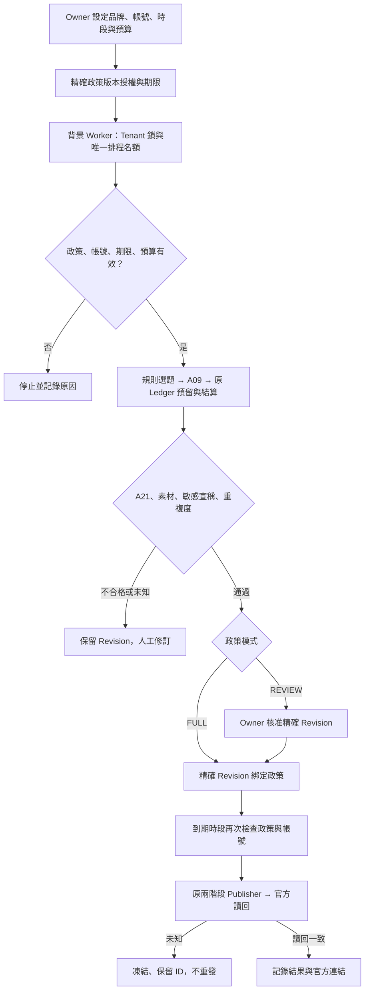

# MOS-AUTO-001 自動化中心

本階段：離線開發與合成 HTTP 驗收。真實模型、真實自動發布、原 DB 升級及原公開環境均未啟用。

## 使用者流程

1. 進入原 `/app`，使用原工作區登入，開啟「自動化中心」。不新增登入流程。
2. 展開「建立自動化政策」，選擇已連接的 Threads 帳號；可沿用內容工作台的品牌需求，或填寫原有品牌欄位。專案沒有獨立 CONTENT-002 品牌資料庫，本次不另造一套。
3. 選模式、模型、每日篇數、星期、Asia/Taipei 時間、每月 AI 預算、起迄日期、候選主題、禁用詞與敏感主題。期間最長 90 天。
4. 全自動模式另填 Owner 核准素材，包含 Hook、正文、CTA。現階段只允許在這些完整段落範圍組文；新事實、語意未知或高風險宣稱交人工，不能用規則冒充真正語意評審。
5. 儲存後為「待授權」。點「核對並啟用政策」會顯示模式、上限及期限，Owner 明確確認精確政策 hash 才生效。這不會解鎖本版的 Live 禁用限制。
6. 有另一份部署／Live 批准且 Worker 已配置後，背景 Worker 自行執行，不需保持瀏覽器開啟。半自動模式只需在內容工作台核准精確 Revision，不需再按逐篇發布；全自動素材範圍內不建立假的 Owner 單篇核准。
7. 在排程清單查看草稿、規則 QA、Revision、模擬或 Provider 來源、費用及錯誤。只有 OFFICIAL_READBACK_VERIFIED 才顯示官方貼文連結；Mock 只顯示「模擬流程完成」。
8. 「暫停全部自動化」立即阻擋後續准入；撤銷不可恢復。變更帳號、限制、品牌或模式一律複製為新版並重新授權，舊版被撤銷。

審核／發布中已送出的外部請求無法保證撤回。暫停後仍需保存其結果，不得隱藏已發生的費用或再送一次。

## 三種模式

| 模式 | 生成 | 發布授權 |
|---|---|---|
| MANUAL | 沿用原內容工作台；政策 Worker 不產文 | 原逐篇核准及確認流程 |
| REVIEW | Worker 產生草稿，QA 不合格停留待審 | Owner 核准精確 Revision 後，政策允許時段內自動發布 |
| FULL | 規則選題＋A09 產文＋A21＋重複／政策檢查 | 有期限的政策授權；不得超出 Owner 核准素材或跳過硬性 QA |

選題是可重現的規則 Agent：從政策主題挑選 30 天內未用者，不假裝研究市場或熱門趨勢。A09 重用既有品牌／產業 Skill 按需載入。A21 使用確定性規則；未知語意沒有捏造 AI 分數。重寫次數目前為 0：不合格直接保留待審，不自動花費或放寬規則。

## 模型金鑰與計價

真實 Provider 沿用現有 OpenAI Responses Adapter、schema／usage 驗證與 LLMProvider 介面；沒有新 SDK。自動化子類只負責政策金鑰取得與既有 Release Gate。DRAFT 政策可透過同源 Owner HTTPS 密碼欄位配置模型 Key，後端使用既有 Fernet 封裝與 Tenant／policy 專用關聯資訊加密，不變更 Windows DPAPI Vault 或原 Threads 金鑰。

Key 不在政策查詢、DOM 回填或 Log 中；送出後清空欄位。本機 HTTP 例外只供 loopback 開發。正式 Key 不貼聊天、URL、Git 或測試輸出。Owner 啟用政策會另產生狹義 automation_worker 憑證並加密保存；Worker 不持有 Owner／管理員登入。

本版 paid transport 仍受既有 `require_execution_release()` 的無條件拒絕保護；環境 true、存入 Key、啟用政策都不能單獨發生費用。這是尚待獨立核准的執行邊界，不能說已驗證真實 AI。

2026-10-27 查核 [OpenAI gpt-6-luna 官方頁](https://developers.openai.com/api/docs/models/gpt-6-luna)：Responses、Structured Outputs；標準短上下文每百萬 Input USD 0.10、Cached Input 0.01、Cache write 0.125、Output 0.50。超長上下文、地區、服務等級等另有條件。既有不可變 2026-10-25 RateVersion 保留；未把重新查核當成 Provider 帳戶可用性證據，也未宣稱所有快取 TTL 或完整 Live 成本上界已驗證。

預留與結算全部重用 Tenant Ledger；政策的月上限只做准入彙總，不是第二套帳本。以台北月份彙總該 Tenant 自動化 Task 的已結算與未決預留，跨政策／版本不歸零；每日名額目前也保守地共用 Tenant 上限。超預留費用完整記帳並暫停 Tenant。本地准入不能保證已送出的外部請求、費率變更或延遲帳單絕不超支。Mock units 是 UTF-8 bytes，OpenAI Mock HTTP usage 是合成 Provider 格式；兩者都不是實際帳單。沒有已驗真 Invoice 時保持 UNVERIFIED。

ChatGPT Plus 不包含本系統可用的 API 額度。本次真實模型呼叫 0，實際 API 費用 USD 0，沒有新增依賴或付費服務。

## 本機 UI 與實際畫面

既有本機內容工作台啟動器仍可使用；在新的獨立驗收 DB 測試，切勿對原部署執行安裝器或 migration。新功能路徑為 `/app/automation`。

`docs/auto001/ui/automation-1440.png`、`automation-768.png`、`automation-390.png` 為真實 Chrome＋隔離 HTTP／DB 的合成資料畫面；`mobile-created-policy.png` 為 390px 表單實際保存後的畫面。不是本人 OAuth 或真實發布證據，也不是實體 iPhone Safari 已測。

## 端到端流程

