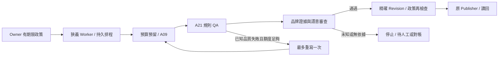

# MOS-AUTO-002 核心修復

來源：`codex/marketing-ai-os-threads-automation` / `787d2544aa51a5ed716286a89a8ed86f406fd0a9`。
交付分支：`codex/marketing-ai-os-auto-core-fixes`。本階段只有離線開發，沒有部署原環境。

## 登出不等於撤銷政策

根因：原 `DELETE /ui/session` 與安全撤權都只設 `Credential.revoked=true`，Worker 無法區分，遂停止已授權政策。
現在一般登出同時記錄 `logged_out_at`，Session 仍立即失效。Worker 使用原有狹義 `automation_worker` 與加密持久化憑證，僅忽略政策核准者的普通登出；政策期限不受 Session 期限限制。
`DELETE /credentials/{id}` 是安全撤權，清除登出原因，立即阻止該憑證核准的政策。兩者使用相同 Tenant lock，晚到的登出不能覆寫安全撤權。
政策撤銷、暫停、Worker 撤權／到期、Tenant 停用、Kill Switch、帳號失效仍停止。舊的 revoked 憑證沒有登出原因，維持停止，沒有擅自補登為登出。

## 自主創作

既有 `/app/automation` 新增內容政策、品牌事實、語意審查來源與最多重寫次數：

- MATERIALS：保留既有核准段落模式，相容舊政策 JSON。
- BRAND_GUIDED：Owner 提供有 ID、來源的品牌事實；允許新 Hook、正文及 CTA，不要求出自核准素材。事實句必須逐字對應 Owner 知識，新的創意句目前保守限於非事實問題／邀請。
- HUMAN_REQUIRED：產文後停在待人工審查，不能憑模型文案自行發布。
- MODEL_REQUIRED：A21 規則通過後，另建 A21 Task 執行嚴格 JSON 語意審查；審查精確綁定全文、每句分段與政策 hash。它不是外部事實查核，不能證明 Owner 所提供事實為真。

缺少證據、錯誤 hash、未覆蓋全文、未支持的品牌／商品／療效／優惠宣稱、空洞／機械式／重複內容皆停止。高風險規則始終硬性阻擋，總分不能繞過。
允許 0 或 1 次重寫；每次 WRITE／SEMANTIC 使用原 Task、RateVersion、Tenant Ledger，新增 append-only attempt 關聯，保留失敗版本及全部成本。未知結果不重寫、不重送。語意模型同樣受原 Live Release Gate 限制，本次只有 Mock HTTP。
`GET /automation/slots/{id}/attempts` 可查每次來源、版本、預留、實際記帳、審查與錯誤。發布時重新核對語意證據及 Revision，不能核准 A、發送 B。

圖中的 Provider 與發布外部呼叫本次均未啟用。測試中的 PUBLISHED 只有 `MOCK_READBACK_PASSED`。

## 最小資料變更與相容性

0015 是 additive：`credentials.logged_out_at`、`ai_test_permits`、`automation_attempts`，不更動舊 Ledger 或舊合成 TestBatch。
新表有 Tenant RLS、同 Tenant Task 外鍵、不可覆寫證據 Trigger、次數約束與 consent 唯一索引。舊政策自動使用 MATERIALS、待人工、零次重寫。
舊任務／成本仍納入月計，新增重寫及審查費用不因 slot 最新 Task 指標改變而遺失。舊 Revision／Approval 不被改寫。
本版 ORM head 為 0015；**不可把本版容器直接接到原 0012 DB**。0013／0014／0015 只在新合成 DB 驗證，本次不升級原 DB、不執行安裝器、不修改 DPAPI。

| 功能 | 首次本機 AI 試驗 | 首次 Threads 測試發文 | 持續自動運行 |
|---|---|---|---|
| 本版隔離資料庫至 0015 | 必要；全新專用 volume | 若部署本版才需要另准升級 | 必要且需正式部署批准 |
| 0013 Privacy Callback 對外驗證／開放 | 不需要 | 依 Meta App 要求另行確認，不能假稱已相容 | 正式營運前完成 |
| 0014 自動化政策 | 隨 migration 鏈存在，不必啟用 | 手動 Publisher 不依賴持續政策 | 必要 |
| 真實帳戶、精確支出與成本證據 | 必要 | 不需 AI 許可即可測指定人工文案 | 另需持續支出批准 |
| 本人指定文案及帳號的發文授權 | 不需要；發文強制關閉 | 必要；另准令牌唯讀驗證及單篇發布 | 不得沿用單篇批准 |
| 原持續 Live Release Gate | 不影響新單次 AI 路徑 | 不擅改原手動 Publisher | 仍鎖定，需另審執行釋出 |

沒有新增依賴、付費服務或常駐服務。沿用 HTTPX、Pydantic、SQLAlchemy、Alembic、pytest、既有 Worker 與備份腳本。
